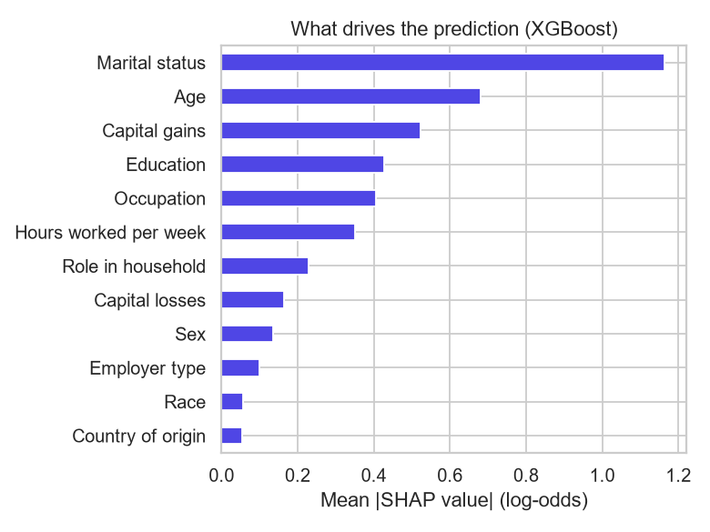

# Income Prediction

Predicts whether a person earns more than $50K a year from census information such as age, education, occupation and hours worked — with a fair, leak-free comparison of six popular models.

**[Live demo →](https://ravshanovna-income.vercel.app)** — fill in a person's profile and get the probability of earning >$50K instantly. The model runs in your browser (ONNX Runtime Web), no server needed.



## Results

Shipped model: **XGBoost** pipeline. Held-out test set (20%, 9,769 people):

| Metric | Score |
|---|---|
| ROC-AUC | **0.931** |
| Accuracy | 87.6% |
| Precision (>50K) | 79.3% |
| Recall (>50K) | 65.4% |
| F1 (>50K) | 0.717 |

5-fold stratified cross-validation on the training set (39,073 people), same folds for every model:

| Model | ROC-AUC | F1 | Accuracy | Fit time per fold* |
|---|---|---|---|---|
| CatBoost | 0.929 | 0.708 | 87.2% | 90 s |
| **XGBoost** (shipped) | 0.929 | 0.713 | 87.4% | 9 s |
| LightGBM | 0.928 | 0.711 | 87.2% | 3 s |
| Gradient Boosting (scikit-learn) | 0.925 | 0.699 | 87.0% | 33 s |
| Random Forest | 0.917 | 0.675 | 86.2% | 22 s |
| Logistic Regression | 0.906 | 0.658 | 85.1% | 1 s |

\*Single CPU thread on a laptop; relative, not absolute, numbers matter. These numbers come from `train.py`; to keep the notebook quick to re-run, its comparison uses 3-fold CV on a stratified half of the training set, and SHAP is computed on a 2,000-person sample.

CatBoost, XGBoost and LightGBM are practically tied (0.0015 ROC-AUC apart). The demo has to run in the browser, so I shipped the best model that converts to ONNX together with its preprocessing: XGBoost (CatBoost's native categorical handling doesn't fit into a scikit-learn ONNX graph). XGBoost also has the best F1 and is 10× faster to train than CatBoost.

## Key findings

- **Marital status** is the strongest signal (married people earn >50K far more often), followed by **age**, **capital gains**, **education** and **occupation** (SHAP).
- Gradient-boosted trees beat logistic regression by ~0.02 ROC-AUC and ~0.05 F1 — interactions (e.g. education × hours) matter.
- **LightGBM** gives almost the same quality as XGBoost/CatBoost at a fraction of the training time.
- Caveat: 1994 census data reflects historical inequalities (sex, race); a model like this should not be used to make decisions about real people.

## Approach

1. **Data** — UCI Adult (48,842 people) loaded from OpenML. Hyphenated columns renamed (`education-num` → `education_num`), missing answers kept as an explicit "Unknown" category, census codes mapped to readable words.
2. **Features** — 12 person attributes; `fnlwgt` (a census sampling weight) and `education_num` (duplicate of `education`) are dropped.
3. **Pipelines** — one scikit-learn `Pipeline` per model, so preprocessing is re-fitted inside every CV fold (no leakage). Dense one-hot encoding: XGBoost/LightGBM treat sparse zeros as missing, which would make the ONNX export disagree.
4. **Model comparison** — Logistic Regression (C tuned by grid search), Random Forest, Gradient Boosting, XGBoost, LightGBM and CatBoost, with stratified 5-fold CV on ROC-AUC, F1 and training time.
5. **Explainability** — SHAP values for the boosted trees (one-hot columns grouped back to the original features).
6. **Deployment** — the full XGBoost pipeline is converted with skl2onnx + onnxmltools and verified against Python (max difference ≈ 5e-7) before shipping.

## Project structure

```
├── notebook.ipynb     # EDA, pipelines, six-model CV comparison, SHAP, evaluation (with outputs)
├── train.py           # reproducible training + ONNX export
├── export_utils.py    # ONNX export / verification helpers
├── requirements.txt
└── web/               # static demo deployed on Vercel
    ├── index.html, app.js, style.css
    ├── model.onnx     # exported pipeline
    ├── meta.json      # form schema, metrics, comparison
    └── assets/        # charts
```

## Run locally

```bash
pip install -r requirements.txt
python train.py                         # downloads data, compares models (~15 min on CPU), writes web/model.onnx
python -m http.server 8000 -d web       # open http://localhost:8000
```

## Tech

Python · pandas · scikit-learn · XGBoost · LightGBM · CatBoost · SHAP · matplotlib/seaborn · skl2onnx/onnxmltools · ONNX Runtime Web · Vercel

**Dataset:** [UCI Adult / Census Income](https://www.openml.org/d/1590) (48,842 people, 1994 US census).
